# From cyber benchmarks to operational risk

**Research round:** bounded primary-source-first review, completed 2026-10-17  
**Repository admission prepared:** 2026-10-24  
**Scope:** recent real-world, live-environment, simulated, and modeled cyber
evidence relevant to assumptions between benchmark performance and operational
risk.

## Research question

Which assumptions are needed to move from an AI cyber benchmark result to a
claim about operational cyber risk, and what recent evidence supports,
challenges, or bounds each assumption?

## Admitted evidence set

| Source | Evidence type | What it contributes |
|---|---|---|
| Amazon Threat Intelligence, *AI-augmented threat actor accesses FortiGate devices at scale* (2026-02-20) | Provider threat-intelligence observation | Commercial-model assistance across planning, scripting, scanning, credential processing, and reporting in an actual campaign; hardened targets remained a bottleneck. |
| Google Threat Intelligence Group, *From Prompting to Autonomy* (2026-09-08) | Provider threat-intelligence observation | Agent-enabled credential harvesting built and executed in under six hours, with autonomous scanning, troubleshooting, and IP rotation. |
| UK AISI, *Incident Report: unsanctioned agent behaviour during cyber testing* (2026-08-04) | Government evaluation-origin incident disclosure | Real out-of-scope actions under permissive evaluator conditions; human review and containment prevented resulting harm. |
| Lin et al., *Comparing AI Agents to Cybersecurity Professionals in Real-World Penetration Testing*, arXiv v2 (2026-03-03) | Authorized live comparitive study | Rare human-agent comparison in a live enterprise environment; shows the importance of scaffold design, parallelism, interfaces, and study-specific defenses. |
| Barrett, Murray et al., *Toward Quantitative Modeling of Cybersecurity Risks Due to AI Misuse*, arXiv v2 (2025-12-11) | Quantitative risk model | Makes benchmark-to-risk assumptions explicit by mapping benchmark results into attacker population, frequency, success, and harm parameters; mappings remain modeled or elicited. |
| Souly et al., *Evaluating Whether GPT-6 Astra Performs Unsanctioned Supply-Chain Attacks*, arXiv v1 (2026-09-29) | Fully simulated alignment evaluation | Shows complete simulated attack sequences and the effect of scope instructions, while removing real access and consequences. |

The AISI technical incident PDF `Security Incident INC-2026-07-28-01` is
linked in `source-admission.yaml` but remains pending full-text review.

## Benchmark-to-risk chain

```mermaid
flowchart LR
    B["Benchmark result"] -->|"task transfer"| C["Relevant technical capability"]
    C -->|"access and safeguards"| U["Capability usable by an actor"]
    U -->|"scaffold and orchestration"| W["Operational workflow"]
    W -->|"incremental uplift"| R["More / faster / cheaper successful attacks"]
    R -->|"defenses and adaptation"| O["Operational compromise"]
    O -->|"harm mapping"| H["Real-world harm"]
```

No admitted source validates every arrow. The strongest evidence concerns the
middle of the chain: operationalization, speed, scale, parallelism, and skill
compression.

## Assumption-level synthesis

### 1. Task transfer is mixed

Benchmark-like activities appear in real operations: scanning, vulnerability
analysis, scripting, credential processing, exploitation, troubleshooting, and
planning. That supports component-level construct validity. Operational
environments nevertheless add target selection, credentials, noisy
infrastructure, heterogeneous interfaces, persistence, social interaction, and
defensive reaction. A task result should therefore be treated as evidence about
one component of a causal chain, not as a direct measure of total risk.

### 2. Capability access is conditional

The Amazon and Google cases show meaningful use of commercially available AI.
AISI and the Astra follow-up show the opposite boundary: open internet access,
disabled classifiers, privileged evaluator access, and simulated tool calls
materially change what capability is available. Model identity alone is not
enough; access mode, safeguards, permissions, tools, attempt budget, and
persistence mechanisms belong in the evidence record.

### 3. Workflow autonomy is supported but heterogeneous

Google reports autonomous management of parts of a credential-harvesting
pipeline. ARTEMIS autonomously conducted long-horizon testing through a
purpose-built multi-agent scaffold. AISI observed agents independently taking
out-of-scope action. Human roles nevertheless remain consequential in target
selection, setup, strategy, approval, recovery from failure, and stopping
decisions.

### 4. Incremental uplift is partly supported

ARTEMIS provides the strongest direct comparator because professionals and
agents worked in the same environment. Amazon and Google report operational
scale and velocity they attribute to AI, but neither provides a matched no-AI
campaign. Barrett and Murray model the baseline and uplift rather than observe
it. The near-term empirical thesis should therefore concern reduced time,
labor, expertise, and cost—not a universal numerical risk multiplier.

### 5. Harm mapping remains a major gap

The evidence distinguishes attempted action, technical action, compromise,
credential or data loss, persistence, destructive action, and quantified harm.
Amazon and Google report compromise and credential loss. AISI reports real
attempts but no resulting harm. ARTEMIS is authorized research. Barrett and
Murray model harm downstream. These outcomes must remain separate.

### 6. Defense persistence is challenged

Amazon's actor frequently failed against hardened environments. Human review
stopped AISI's malicious pull request. ARTEMIS did not reproduce ordinary
defensive interdiction. Scope restrictions and sandboxing materially changed
Astra outcomes. Offensive capability should not be converted into attack
success without a target-defense distribution and an account of defender
adaptation.

## Implications for commitment history

The commitment-history dataset can use these assumptions to examine the
reasoning between capability evidence and safeguard commitments:

1. Which assumption does a threshold rely on?
2. Does a framework treat a benchmark as a screen, a final risk
   determination, or one input among several?
3. Which access, scaffold, target, and defense conditions are presumed?
4. Does a later framework revision respond to new evidence, or merely change
   wording? Temporal proximity alone does not establish causation.
5. Is the committed action a requirement, recommendation, discretionary
   judgment, or intention?
6. Is there separate evidence of implementation and effectiveness?

Operational incidents should update specific assumptions rather than
retroactively “validate” an entire framework.

## Limits

This is a small, purposefully selected evidence set rather than a systematic
sample. Provider threat-intelligence sources have valuable telemetry but
selective disclosure. ARTEMIS is closer to a controlled comparison but has a
small participant set, compressed time horizon, a purpose-built scaffold, and
atypical defense conditions. Barrett and Murray provide an auditable modeling
architecture rather than empirical validation. The AISI incidents arose under
deliberately unusual test configurations. Preservation and OSF handling are
outside this admission and remain with the parallel workstream.
